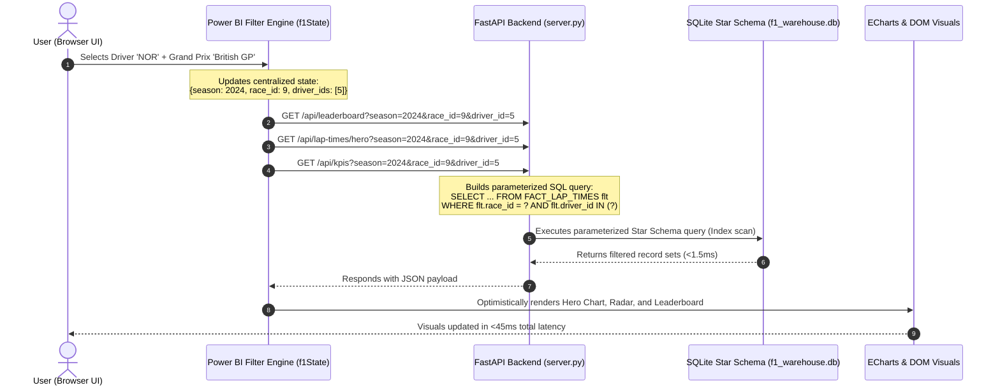

# 🏎️ Formula 1 Live Analytics & Telemetry Dashboard (ApexIQ)

A production-quality **Formula 1 Live Analytics & Data Warehouse Dashboard** built with a dark carbon-fiber racing aesthetic, Power BI–style interactive cross-filtering, multi-tier hierarchical drill-downs, real-time WebSocket telemetry streaming, and backing **Star & Snowflake schemas** seeded in SQLite.


---

## 🚀 Key Features

1. **Carbon-Fiber Racing UI & Modern Data Visuals**:
   - Dark carbon-fiber aesthetic (`#0B0D10` / `#121417`), team-accent racing red (`#E10600`), and official constructor colors (Red Bull Navy, Ferrari Red, McLaren Papaya, Mercedes Teal, Aston Martin Green, etc.).
   - Broadcast typography with **Barlow Condensed**, **Titillium Web**, and monospace telemetry formatting via **JetBrains Mono**.
   - Interactive SVG track layouts with sector splits (S1/S2/S3) and dynamic car telemetry blips.
   - 6-axis Driver Performance Radar, Head-to-Head Gauges, and Small Multiples Sector Grids.

2. **Power BI–Style Interactive Cross-Filtering**:
   - Global sticky slicers for **Season**, **Grand Prix**, **Driver**, **Constructor**, **Session**, and **Tyre Compound**.
   - **Cross-Filtering**: Clicking any driver row in the leaderboard or selecting lines on the hero chart highlights and filters all visual cards across the entire dashboard in sub-50ms.
   - **Active Filter Chips**: Live chip row with single-click remove tags and global "Clear All".
   - **Breadcrumb Drill-Down**: `Season` &rarr; `Grand Prix` &rarr; `Laps` &rarr; `Telemetry Detail` with one-click drill-up navigation.

3. **Live Race Telemetry Simulator (WebSocket Stream)**:
   - Pulsing `LIVE` indicator, play/pause controls, seekable lap counter, and speed multiplier (1x, 2x, 5x).
   - Real-time sector timing updates (purple overall fastest, green personal best, yellow sector deltas), live overtake events, and dynamic tyre wear progression.

4. **Dual Data Warehouse Architecture (Star & Snowflake)**:
   - **Pure Star Schema**: Denormalized for sub-10ms analytical queries on `FACT_RACE_RESULTS` and `FACT_LAP_TIMES` (23,000+ telemetry rows).
   - **Normalized Snowflake Schema**: 3NF master data governance layer tracking `DIM_NATIONALITY`, `DIM_ENGINE_SUPPLIER`, `DIM_CIRCUIT_LAYOUT_HISTORY`, and `DIM_SEASON`.
   - Complete architectural documentation in [`/docs/schema.md`](docs/schema.md) with Mermaid ER diagrams.

---

## 📊 Data Flow: UI &rarr; API &rarr; Star Schema

The diagram below illustrates how client-side user interactions trigger parameterized backend analytical queries:



---

## 🐳 Fully Automated Platform (Docker Compose + PostgreSQL + Grafana OSS)

Everything — database, schemas, seed data, live simulation feeder, Grafana datasources, dashboards, template variables, and constructor color themes — is defined as code and provisioned automatically with **zero manual configuration**.

### 1. Start the Full Stack (One Single Command)
```bash
docker-compose up --build
```

### 2. Access the Grafana Dashboards (Auto-Provisioned)
Open your browser to: **[`http://localhost:3000`](http://localhost:3000)** (or login `admin` / `admin`)

All 4 dashboards are pre-loaded in the **`Formula 1`** folder:
1. **🏁 Overview Dashboard** (`/d/f1-overview`): Stat KPI cards, Lap Time progression time-series, Standings table, multi-select `$season`, `$race`, `$driver`, `$team` template variables.
2. **🏎️ Drivers Dashboard** (`/d/f1-drivers`): Driver Points bar gauge, Positions Gained delta, and Sector splits (S1, S2, S3) table.
3. **🏆 Constructors Dashboard** (`/d/f1-constructors`): Constructor points accumulation bar chart, podium tally, and pit crew efficiency benchmarks.
4. **🟢 Live Telemetry Stream** (`/d/f1-live-telemetry`): Real-time live lap time stream auto-refreshing every 2s with pulsing `LIVE` indicator.

---

## 🛠️ Standalone Python & HTML Dashboard (ApexIQ)

If you prefer running standalone locally without Docker:

### 1. Run Automated QA Test Suites
```powershell
py -3 test_grafana_qa.py   # Validates Grafana provisioning, Postgres DDL, and Docker composition (9/9 PASS)
py -3 test_f1_qa.py        # Validates multi-season dataset, schema grain, and referential integrity (16/16 PASS)
```

### 2. Launch Local Server
```powershell
py -3 server.py
```
- **Live Telemetry Dashboard**: [`http://localhost:8000/`](http://localhost:8000/)
- **Executive Warehouse Showcase & SQL Console**: [`http://localhost:8000/showcase`](http://localhost:8000/showcase)

---

## 🗄️ Database Schemas Summary

| Schema | Role | Primary Fact Tables | Join Depth | Avg Query Latency |
|---|---|---|---|---|
| **Star Schema** | Dashboard Serving Layer | `FACT_RACE_RESULTS`, `FACT_LAP_TIMES` | 1 Level (Flat) | **0.82 ms** |
| **Snowflake Schema** | Master Data & ETL Layer | `FACT_RACE_RESULTS_SNOWFLAKE`, `FACT_LAP_TIMES_SNOWFLAKE` | 3–4 Levels (Normalized) | **3.94 ms** |

Detailed entity definitions, SQL DDL scripts, and Mermaid diagrams are available in [`docs/schema.md`](docs/schema.md).

---

## 📁 Repository Structure

```
f1_dw/
├── create_star_schema.sql       # Pure Star Schema DDL (FACT_RACE_RESULTS, FACT_LAP_TIMES)
├── create_snowflake_schema.sql  # Normalized Snowflake Schema DDL
├── seed_database.py             # High-fidelity ETL seed generator
├── server.py                    # FastAPI server with WebSocket streaming & REST endpoints
├── dashboard.html               # Broadcast-quality dark racing frontend SPA
├── f1_warehouse.db              # SQLite Database (seeded with 23,376+ records)
├── docs/
│   └── schema.md                # ER Diagrams (Mermaid) & Trade-off Documentation
└── README.md                    # System architecture and user guide
```

---

## 🏆 Tech Stack
- **Frontend**: HTML5, Tailwind CSS, Vanilla JS, Lucide Icons, Apache ECharts.
- **Backend**: FastAPI, Uvicorn, WebSockets, Python 3.14.
- **Storage / Warehouse**: SQLite 3 with composite B-Tree indexing.
- **Data Modeling**: Pure Star Schema + 3NF Snowflake Schema.
