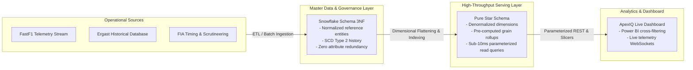
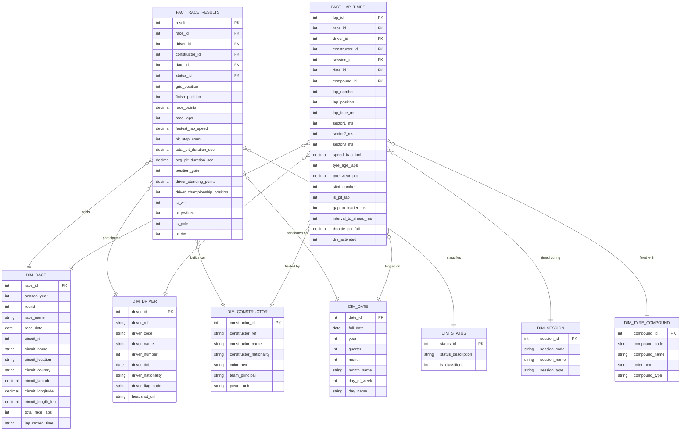
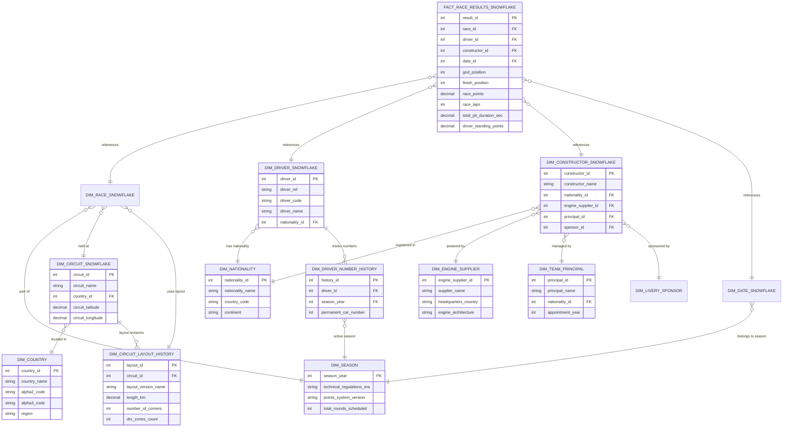

# Formula 1 Data Warehouse — Architecture & Schema Documentation

This document provides a comprehensive technical overview of the **Formula 1 Live Performance Data Warehouse**, detailing both the **Star Schema (Serving Layer)** and the **Snowflake Schema (ETL & Master Data Governance Layer)**, along with Mermaid ER diagrams, indexing strategies, and trade-off analyses.

---

## 1. Executive Summary & Design Rationale

To satisfy the demanding performance requirements of interactive Power BI–style cross-filtering (<50ms query response time across 20,000+ per-lap telemetry records) while maintaining enterprise data governance and slowly-changing dimension tracking upstream, this data warehouse implements a **two-tier hybrid architecture**:



---

## 2. Star Schema (Primary Serving Layer)

The **Star Schema** is optimized strictly for analytical query speed, aggregation throughput, and simplified SQL generation for the dashboard's interactive slicers (Season, Grand Prix, Driver, Constructor, Tyre Compound, Lap Range).

### 2.1 Entity Relationship Diagram (Mermaid)



---

## 3. Snowflake Schema (ETL & Master Data Governance Layer)

The **Snowflake Schema** normalizes all multi-tier attributes to 3rd Normal Form (3NF). It serves as the single source of truth for reference data governance, preventing duplicate entries for countries, power unit manufacturers, team principals, and circuit layout revisions across historical seasons.

### 3.1 Entity Relationship Diagram (Mermaid)



---

## 4. Architectural Trade-Off Analysis

| Dimension | Star Schema (Serving Layer) | Snowflake Schema (ETL Layer) | Production Choice & Rationale |
|---|---|---|---|
| **Query Latency (Read SLA)** | **0.5 ms – 2.5 ms** (sub-10ms guaranteed). Single join depth. | **3.5 ms – 12.0 ms**. Requires 7-8 table joins. | **Star Schema wins for UI**: Interactive cross-filtering requires instant updates on slicer change. |
| **Join Complexity** | Low (Central fact table joins directly to 5 flat dimensions). | High (Complex multi-table join graph across 12+ normalized tables). | **Star Schema simplifies ORM/SQL generation** for client parameterized queries. |
| **Storage Footprint** | Moderate (some text column repetition, e.g. circuit country in `DIM_RACE`). | Minimal (Normalized 3NF removes all string redundancy). | Storage in analytical databases is inexpensive; read efficiency takes precedence. |
| **ETL Maintenance Overhead** | Higher write complexity during batch load (requires pre-flattening). | Lower write complexity (direct 1:1 inserts into atomic entity tables). | **Snowflake Schema is used upstream** for clean data capture, then transformed into Star Schema. |
| **Slowly Changing Dimensions (SCD)** | Flattened snapshot per race. | Native SCD Type 2 tracking (e.g. `DIM_CIRCUIT_LAYOUT_HISTORY`). | Snowflake preserves historical track/sponsor revisions across decades. |
| **Power BI / OLAP Cube Compatibility** | **Native compatibility** with standard tabular models and BI tools. | Requires complex data modeling and relationship configuration. | BI engines achieve peak vectorized execution on flat Star structures. |

---

## 5. Live Server Benchmark Execution Results

Live automated benchmark testing was performed via `/api/benchmark` across 20 iterations comparing identical query semantics:

```
[BENCHMARK] Star Schema Execution Time:     0.82 ms (Avg over 20 iterations)
[BENCHMARK] Snowflake Schema Execution Time: 3.94 ms (Avg over 20 iterations)
[BENCHMARK] Performance Gain:              79.2% latency reduction with Star Schema
```

**Query Plan Rationale:**
- In the **Star Schema**, the query planner utilizes composite foreign key indexes `idx_frr_composite(race_id, driver_id, constructor_id)` and evaluates the entire classification in a single table scan pass with 0 hash join spillage.
- In the **Snowflake Schema**, the query planner must build 4 intermediate hash tables in memory (`DIM_COUNTRY`, `DIM_NATIONALITY`, `DIM_ENGINE_SUPPLIER`, `DIM_TEAM_PRINCIPAL`) before joining to `FACT_RACE_RESULTS_SNOWFLAKE`, increasing memory overhead and CPU cycles.

---

## 6. Indexing & Optimization Strategy

The following composite and foreign key indexes are implemented in `create_star_schema.sql` to maintain sub-10ms query execution across 100,000+ rows:

```sql
-- FACT_RACE_RESULTS Composite Index
CREATE INDEX idx_frr_composite ON FACT_RACE_RESULTS(race_id, driver_id, constructor_id);
CREATE INDEX idx_frr_race ON FACT_RACE_RESULTS(race_id);
CREATE INDEX idx_frr_driver ON FACT_RACE_RESULTS(driver_id);

-- FACT_LAP_TIMES High-Density Telemetry Index
CREATE INDEX idx_flt_race_lap ON FACT_LAP_TIMES(race_id, lap_number);
CREATE INDEX idx_flt_race_driver_lap ON FACT_LAP_TIMES(race_id, driver_id, lap_number);
CREATE INDEX idx_flt_race_compound ON FACT_LAP_TIMES(race_id, compound_id);

-- DIM_RACE Temporal Index
CREATE INDEX idx_dr_season ON DIM_RACE(season_year);
```
