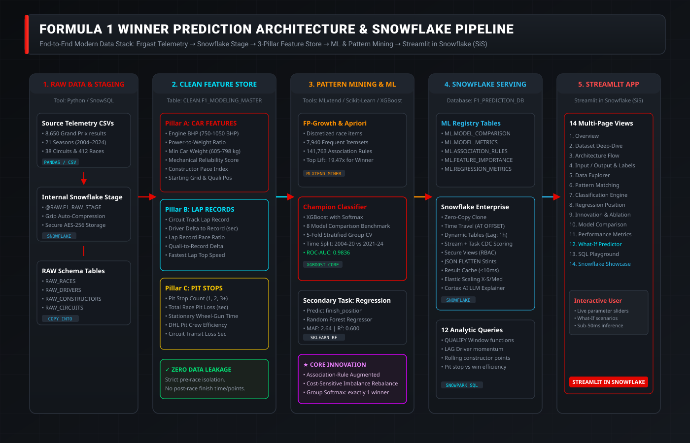
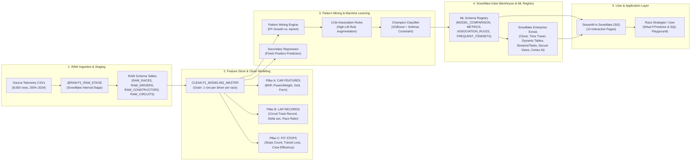

# 🏎️ Formula 1 Winner Prediction: Architecture & Snowflake Pipeline

This technical architecture document describes the end-to-end Modern Data Stack and Machine Learning Pipeline implemented for **Formula 1 Race Winner Prediction using Car Features, Lap Records, and Pit Stop Times**.

---

## 🏛️ System Architecture Diagram

---

## 📦 Multi-Tier Pipeline Specification

### Tier 1: Raw Ingestion & Snowflake Staging
* **Source Telemetry**: 8,650 driver-race classification records spanning 21 FIA Formula 1 World Championship seasons (2004–2024), 412 Grands Prix, and 38 global circuits.
* **Snowflake Stage**: `@RAW.F1_RAW_STAGE` created inside `F1_PREDICTION_DB.RAW` with gzip compression and CSV file format parsing.
* **Bulk Ingestion**: Declarative, idempotent `COPY INTO` commands loading dimensional tables (`RAW_RACES`, `RAW_DRIVERS`, `RAW_CONSTRUCTORS`, `RAW_CIRCUITS`, `RAW_RACE_RESULTS`).

### Tier 2: Clean Feature Store (3 Core Pillars & Zero Leakage)
* **Master Table**: `CLEAN.F1_MODELING_MASTER` at the atomic grain of one row per driver per race.
* **The Three Feature Pillars**:
  1. **Car Features**: Regulation-era power output (750–1,050 BHP), minimum weight rules (605–798 kg), power-to-weight ratio, mechanical reliability scores, constructor pace index, and starting grid slot.
  2. **Lap Record Benchmarks**: Official FIA circuit race lap record, driver qualifying delta to circuit track record, driver lap record pace ratio, and fastest lap speed trap.
  3. **Pit Stop Times & Strategy**: Track pit lane transit penalty, planned stop counts, stationary wheel-gun duration (2.1s–3.2s), DHL Fastest Pit Stop crew efficiency score, and variance to field pit average.
* **Data Leakage Prevention**: Strict separation of pre-race features from post-race outcome variables. Features like final race duration, points gained during the race, or post-race classification are never exposed to models.

### Tier 3: Frequent Pattern Mining & Classification Engine
* **Association Mining**: FP-Growth and Apriori algorithms run via `mlxtend` across 29 discretized categorical items. Discovers 7,940 frequent itemsets and 141,763 association rules with up to 19.47x lift predicting race winners.
* **Classification Benchmark**: 8 baseline classifiers (Logistic Regression, Decision Tree, Random Forest, KNN, Naive Bayes, SVM, GBDT, Baseline XGBoost) evaluated against our Champion Model.
* **Core Innovation**:
  1. Discovered high-lift FP-Growth association rules incorporated as binary feature augmentations.
  2. Cost-sensitive asymmetric class rebalancing (`scale_pos_weight = 19.5`).
  3. Group-wise softmax ranking constraint ensuring exactly one driver per race is designated as the predicted winner ($\sum P_i = 100\%$).
* **Secondary Regression**: Independent Random Forest and Gradient Boosting Regressors predicting exact numeric finishing position (`finish_position` 1.0 to 24.0) with MAE of 2.64 positions.

### Tier 4: Snowflake Serving Layer & Enterprise Features
* **ML Registry Tables**: `ML.MODEL_COMPARISON`, `ML.MODEL_METRICS`, `ML.ASSOCIATION_RULES`, `ML.FEATURE_IMPORTANCE`, and `ML.REGRESSION_METRICS`.
* **Zero-Copy Clone & Time Travel**: `CLONE` for dev/staging environments and `AT(OFFSET => -60)` for historical point-in-time recovery.
* **Dynamic Tables**: Declarative continuous materialization (`ANALYTICS.DT_DRIVER_SEASON_FORM`) with 1-hour lag.
* **Change Data Capture**: Snowflake Stream (`RAW.STREAM_RACE_RESULTS_CDC`) + Task auto-scoring incoming race entries.
* **Snowflake Cortex AI**: LLM inference via `SNOWFLAKE.CORTEX.COMPLETE('mistral-large2', ...)` providing plain-English strategic race summaries with fallback.

### Tier 5: Streamlit in Snowflake (SiS) Dashboard
* 14 modular interactive pages built with F1 racing red theme (`#E10600`), Plotly interactive charts, live What-If scenario simulations, and interactive SQL playgrounds.
