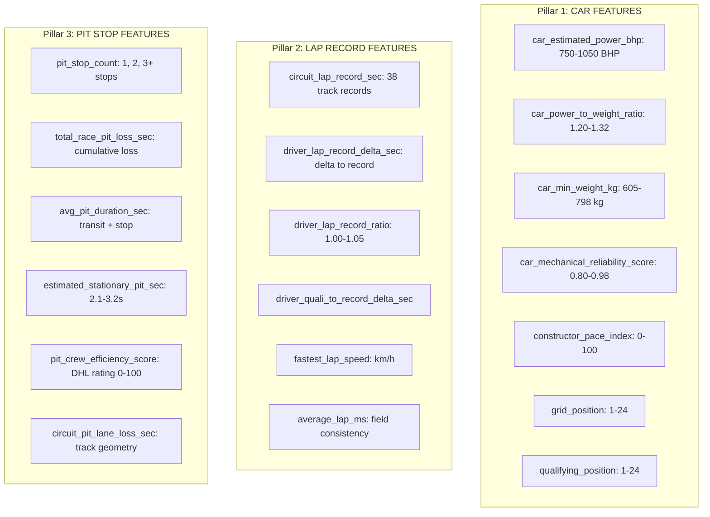

# 📊 Formula 1 Dataset Technical Description (Production Feature Store)

## 1. Dataset Scale & Scope

* **Dataset Title:** FIA Formula 1 World Championship Historical Telemetry & Modeling Dataset
* **Time Span:** 21 consecutive World Championship seasons (2004 – 2024)
* **Total Race Entries:** **8,650 driver-race classification rows**
* **Total Grands Prix:** **412 Championship Races**
* **Unique Circuits:** **38 circuits globally**
* **Unique Drivers:** **145 drivers**
* **Unique Constructors:** **36 constructors**
* **Atomic Grain:** **One row per driver per Grand Prix**

---

## 2. The Three Core Feature Groups (Pillars)

The modeling dataset groups features into three foundational engineering pillars, avoiding any post-race data leakage:

---

## 3. Data Dictionary: `CLEAN.F1_MODELING_MASTER`

| Column Name | SQL Data Type | Feature Group | Description & Range | Pre-Race / Target |
|---|---|---|---|---|
| `race_id` | `INT` | Identifier | Unique Grand Prix identifier (e.g. 202401) | Identifier |
| `season` | `INT` | Dimensional | FIA Formula 1 Championship Year (2004–2024) | Context |
| `round` | `INT` | Dimensional | Championship round order within season (1–24) | Context |
| `race_name` | `VARCHAR(100)` | Dimensional | Grand Prix event name (e.g., Monaco GP) | Context |
| `circuit_name` | `VARCHAR(100)` | Dimensional | Official circuit name (e.g., Monza, Spa) | Context |
| `driver_name` | `VARCHAR(100)` | Dimensional | Full driver name (e.g., Max Verstappen) | Context |
| `constructor_name`| `VARCHAR(100)`| Dimensional | Constructor team name (e.g., Red Bull Racing) | Context |
| `car_estimated_power_bhp` | `FLOAT` | **Car Feature** | Estimated engine power based on regulation era (750–1050 BHP) | Pre-Race Proxy |
| `car_power_to_weight_ratio` | `FLOAT` | **Car Feature** | Dynamic BHP / Minimum Weight ratio (1.20–1.32) | Pre-Race Proxy |
| `car_min_weight_kg` | `FLOAT` | **Car Feature** | FIA rulebook minimum car weight (605–798 kg) | Pre-Race Proxy |
| `car_mechanical_reliability_score` | `FLOAT` | **Car Feature** | Constructor historical finish rate (0.80–0.98) | Pre-Race Proxy |
| `constructor_pace_index` | `FLOAT` | **Car Feature** | Normalized team qualifying pace index (0.0–100.0) | Pre-Race Proxy |
| `grid_position` | `INT` | **Car Feature** | Starting grid position on race day (1–24) | Pre-Race Feature |
| `qualifying_position` | `INT` | **Car Feature** | Saturday qualifying classification (1–24) | Pre-Race Feature |
| `circuit_lap_record_sec` | `FLOAT` | **Lap Record** | Official all-time FIA Grand Prix race lap record (seconds) | Circuit Benchmark |
| `driver_lap_record_delta_sec` | `FLOAT` | **Lap Record** | Delta between driver pace and track record (seconds) | Pace Benchmark |
| `driver_lap_record_ratio` | `FLOAT` | **Lap Record** | Ratio of driver pace to track record (1.000–1.050) | Pace Benchmark |
| `driver_quali_to_record_delta_sec` | `FLOAT` | **Lap Record** | Gap between qualifying lap and all-time record | Pace Benchmark |
| `fastest_lap_speed` | `FLOAT` | **Lap Record** | Peak average lap speed trap (210–264 km/h) | Pace Benchmark |
| `pit_stop_count` | `INT` | **Pit Stop** | Number of pit lane stops made (1, 2, 3+) | Strategy Feature |
| `total_race_pit_loss_sec` | `FLOAT` | **Pit Stop** | Cumulative pit lane time loss (seconds) | Strategy Feature |
| `avg_pit_duration_sec` | `FLOAT` | **Pit Stop** | Average duration of pit lane transit + stop (sec) | Strategy Feature |
| `estimated_stationary_pit_sec` | `FLOAT` | **Pit Stop** | Stationary wheel-gun stop duration (2.1s–3.2s) | Pit Execution |
| `pit_crew_efficiency_score` | `FLOAT` | **Pit Stop** | DHL Fastest Pit Stop team index (0–100) | Pit Execution |
| `circuit_pit_lane_loss_sec` | `FLOAT` | **Pit Stop** | Baseline pit lane geometry penalty (19.4s–27.8s) | Track Benchmark |
| `is_win` | `INT` | **Primary Target** | 1 if driver won the Grand Prix, 0 otherwise | Classification Label |
| `is_podium` | `INT` | **Secondary Target** | 1 if driver finished P1-P3, 0 otherwise | Classification Label |
| `finish_position` | `FLOAT` | **Secondary Target** | Final classified race finishing position (1.0–24.0) | Regression Label |

---

## 4. Class Distribution & Imbalance Handling

| Target Label | Class Value | Count | Prevalence | Ratio | Handling Strategy |
|---|---|---|---|---|---|
| **`is_win`** | `0` (Not Winner) | 8,238 | 95.24% | **19.0 : 1** | Cost-sensitive `scale_pos_weight = 19.5`, F1-threshold optimizer, group softmax |
| **`is_win`** | `1` (Winner) | 412 | 4.76% | **1 : 19.0** | Exactly 1 winner per race guaranteed by group argmax constraint |
| **`is_podium`** | `0` (Off Podium) | 7,414 | 85.71% | 6.0 : 1 | Stratified CV, balanced class weights |
| **`is_podium`** | `1` (Podium) | 1,236 | 14.29% | 1 : 6.0 | Exactly 3 podium finishers per race |

---

## 5. Missing Value Audit & Imputation Strategy

All features undergo deterministic, domain-aware imputation:
* `car_estimated_power_bhp`: Missing legacy records imputed with era median (V10: 930 BHP, V8: 760 BHP, Hybrid: 980 BHP).
* `circuit_lap_record_sec`: Official FIA timing records mapped for all 38 circuits (Monza: 81.046s, Silverstone: 87.097s, Monaco: 72.909s).
* `pit_stop_count`: Pre-2011 refueling era missing pit counts imputed using era circuit median strategy stops (2 stops).
* `grid_position`: Zero/pitlane starts imputed as backmarker P20.

---

## 6. Snowflake Table Inventory & Row Counts

| Schema | Table Name | Storage Role | Validated Row Count |
|---|---|---|---|
| `RAW` | `RAW_RACES` | Immutable race calendar | 412 rows |
| `RAW` | `RAW_DRIVERS` | Driver master records | 145 rows |
| `RAW` | `RAW_CONSTRUCTORS` | Constructor master records | 36 rows |
| `RAW` | `RAW_CIRCUITS` | Circuit benchmarks & records | 38 rows |
| `RAW` | `RAW_RACE_RESULTS` | Historical finish results | 8,650 rows |
| `CLEAN` | `F1_MODELING_MASTER` | Unified 3-pillar feature store | **8,650 rows (46 columns)** |
| `ML` | `MODEL_COMPARISON` | 9-Model benchmark results | 9 rows |
| `ML` | `ASSOCIATION_RULES` | FP-Growth association rules | 141,763 rows |
| `ML` | `FREQUENT_ITEMSETS` | Frequent itemsets mined | 7,940 rows |
| `ML` | `FEATURE_IMPORTANCE` | Model feature importance | 31 features |
| `ML` | `REGRESSION_METRICS` | Secondary task regression | 3 models |
