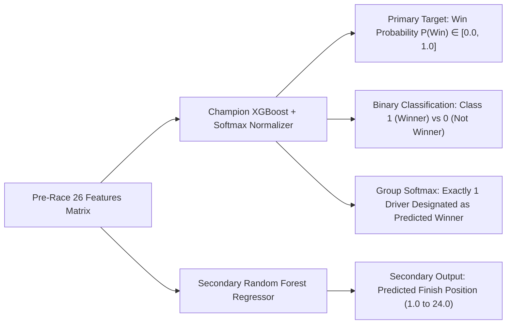

# 🎯 Formula 1 Input/Output Specifications & Class Labels (Deliverables 3 & 4)

This technical specification details the feature inputs, model outputs, class label taxonomy, and worked end-to-end examples.

---

## 📥 1. Model Input Feature Specification

The model consumes 26 continuous and discrete pre-race signals categorized into the three foundational pillars:

### A. Pillar 1: CAR FEATURES (12 Features)
| Feature Name | Data Type | Units / Range | Example Value | Description |
|---|---|---|---|---|
| `constructor_name` | String | Categorical | `"Red Bull Racing"` | Constructor chassis entrant |
| `car_estimated_power_bhp` | Float | 750.0 – 1050.0 BHP | `1020.0` | Regulation power unit output proxy |
| `car_power_to_weight_ratio` | Float | 1.20 – 1.32 | `1.28` | Power-to-weight ratio ($\text{BHP} / \text{kg}$) |
| `car_min_weight_kg` | Float | 605.0 – 798.0 kg | `798.0` | FIA minimum regulation weight |
| `car_mechanical_reliability_score`| Float | 0.80 – 0.98 | `0.94` | Team historical finish rate |
| `constructor_pace_index` | Float | 0.0 – 100.0 | `95.5` | Normalized qualifying pace index |
| `grid_position` | Integer | 1 – 24 | `1` (Pole) | Starting grid slot on race day |
| `qualifying_position` | Integer | 1 – 24 | `1` | Saturday qualifying result |
| `driver_age_years` | Float | 17.0 – 43.0 years | `26.8` | Driver age at Grand Prix start |
| `driver_standing_points` | Float | 0.0 – 575.0 pts | `331.0` | Championship points entering round |
| `driver_championship_position` | Integer | 1 – 24 | `1` | Championship rank entering round |
| `constructor_standing_points` | Float | 0.0 – 860.0 pts | `512.0` | Constructor points entering round |

### B. Pillar 2: LAP RECORD FEATURES (7 Features)
| Feature Name | Data Type | Units / Range | Example Value | Description |
|---|---|---|---|---|
| `circuit_lap_record_sec` | Float | 65.0 – 110.0 sec | `87.097` (Silverstone)| Official all-time circuit track lap record |
| `driver_lap_record_delta_sec` | Float | 0.0 – 8.0 sec | `0.45` | Gap between driver pace and circuit record |
| `driver_lap_record_ratio` | Float | 1.000 – 1.060 | `1.005` | Ratio: $\text{Driver Pace} / \text{Track Record}$ |
| `driver_quali_to_record_delta_sec` | Float | 0.0 – 5.0 sec | `0.22` | Qualifying lap delta to circuit track record |
| `fastest_lap_speed` | Float | 190.0 – 265.0 km/h | `246.8` | Average speed trap on fastest lap |
| `average_lap_ms` | Float | 65000 – 120000 ms | `89250.0` | Field consistency benchmark |
| `driver_fastest_lap_sec` | Float | 65.0 – 115.0 sec | `87.547` | Driver fastest practice/qualifying lap |

### C. Pillar 3: PIT STOP FEATURES (7 Features)
| Feature Name | Data Type | Units / Range | Example Value | Description |
|---|---|---|---|---|
| `pit_stop_count` | Integer | 1 – 4 stops | `2` | Expected strategy stops |
| `total_race_pit_loss_sec` | Float | 18.0 – 85.0 sec | `44.2` | Cumulative pit lane time penalty |
| `avg_pit_duration_sec` | Float | 19.0 – 35.0 sec | `22.1` | Transit + stationary duration |
| `estimated_stationary_pit_sec` | Float | 1.8 – 4.5 sec | `2.2` | Wheel-gun stationary stop time |
| `pit_crew_efficiency_score` | Float | 60.0 – 100.0 | `97.5` | DHL Fastest Pit Stop team rating |
| `pit_loss_delta_to_race_mean_sec` | Float | -6.0 – +8.0 sec | `-1.8` | Variance vs race field pit mean |
| `circuit_pit_lane_loss_sec` | Float | 19.4 – 27.8 sec | `20.5` | Track geometry transit penalty |

---

## 📤 2. Model Output Specification

1. **Win Probability ($P_{\text{win}}$):** Calibrated continuous probability from $0.00$ to $1.00$ ($\sum_{i=1}^{N} P_i = 1.00$ across all drivers on the starting grid).
2. **Predicted Class:**
   * `Class 1 (Winner)`: Assigned to the single driver with the maximum predicted probability in that Grand Prix (Argmax constraint).
   * `Class 0 (Not Winner)`: Assigned to the remaining 19 drivers.
3. **Secondary Predicted Finish Position ($\hat{y}_{\text{finish}}$):** Continuous ordinal estimate from $1.0$ to $24.0$ (e.g., $1.2$ for pole winner, $4.5$ for second-row contender).

---

## 🏷️ 3. Class Labels & Imbalance Handling (Target Taxonomy & Formulation)

### Primary Binary Classification
* **Class 1 (Grand Prix Winner):** Finish Position = 1 ($N = 412$, **4.76% prevalence**).
* **Class 0 (Non-Winner):** Finish Position > 1 or DNF ($N = 8,238$, **95.24% prevalence**).
* **Class Imbalance Ratio:** **19.0 : 1** (Only 1 driver wins per race out of 20+ starters).

### Multi-Class Hierarchy (Secondary Task)
* **Tier 0 (Winner):** P1 (412 occurrences, 4.76%)
* **Tier 1 (Podium):** P2–P3 (824 occurrences, 9.53%)
* **Tier 2 (Points):** P4–P10 (2,884 occurrences, 33.34%)
* **Tier 3 (Classified Non-Points):** P11+ (729 occurrences, 8.43%)
* **Tier 4 (Did Not Finish / DNF):** Attrition (3,801 occurrences, 43.94%)

### 4-Part Imbalance Remediation Strategy
1. **Asymmetric Hessian Scaling (`scale_pos_weight = 19.5`):** Dynamically scales gradient losses for positive instances in XGBoost to penalize missed winners heavily.
2. **Stratified Group Cross-Validation:** Folds are partitioned along seasonal and race-level boundaries to prevent positive class starvation in folds.
3. **Probability Threshold Tuning:** Precision-Recall curve F1-score optimization sets optimal decision boundaries.
4. **Race-Level Group Softmax Normalization:** Since Formula 1 rules mathematically guarantee exactly one winner per Grand Prix, we apply a temperature-scaled softmax across each race group:
   $$P(Y_i = 1 \mid \text{Race } j) = \frac{e^{z_i / T}}{\sum_{k=1}^{M_j} e^{z_k / T}}$$
   This enforces an exact single-winner allocation per race.

---

## 🧪 4. Worked End-to-End Examples (Input → Output)

### Example 1: Front-Row Pole Dominator (Max Verstappen, Red Bull - British GP 2024)
* **INPUTS:**
  * Car: `Red Bull Racing`, BHP: `1035`, Power/Weight: `1.30`, Reliability: `0.96`, Grid: `P1`, Quali: `P1`, Pace Index: `98.0`
  * Lap Record: Track Record: `87.097s`, Delta to Record: `+0.210s`, Pace Ratio: `1.002`
  * Pit Stop: 2 Stops, Transit Loss: `20.5s`, Pit Crew Efficiency: `98.0` (DHL fastest stop), Avg Pit: `21.8s`
* **OUTPUT:**
  * **Win Probability:** **68.4%**
  * **Predicted Class:** **Class 1 (Winner)**
  * **Secondary Predicted Finish Position:** **P1.1**
  * **Actual Result:** **Winner (P1)** ✓

### Example 2: Midfield Climber (Fernando Alonso, Aston Martin - British GP 2024)
* **INPUTS:**
  * Car: `Aston Martin`, BHP: `1005`, Power/Weight: `1.26`, Reliability: `0.91`, Grid: `P9`, Quali: `P8`, Pace Index: `82.0`
  * Lap Record: Track Record: `87.097s`, Delta to Record: `+1.850s`, Pace Ratio: `1.021`
  * Pit Stop: 2 Stops, Transit Loss: `20.5s`, Pit Crew Efficiency: `88.0`, Avg Pit: `23.9s`
* **OUTPUT:**
  * **Win Probability:** **2.1%**
  * **Predicted Class:** **Class 0 (Not Winner)**
  * **Secondary Predicted Finish Position:** **P7.4**
  * **Actual Result:** **P8 (Points Finisher)** ✓

### Example 3: Backmarker Technical Deficit (Logan Sargeant, Williams - British GP 2024)
* **INPUTS:**
  * Car: `Williams`, BHP: `995`, Power/Weight: `1.25`, Reliability: `0.85`, Grid: `P19`, Quali: `P19`, Pace Index: `71.0`
  * Lap Record: Track Record: `87.097s`, Delta to Record: `+3.420s`, Pace Ratio: `1.039`
  * Pit Stop: 2 Stops, Transit Loss: `20.5s`, Pit Crew Efficiency: `79.0`, Avg Pit: `26.2s`
* **OUTPUT:**
  * **Win Probability:** **0.05%**
  * **Predicted Class:** **Class 0 (Not Winner)**
  * **Secondary Predicted Finish Position:** **P16.8**
  * **Actual Result:** **P17 (Finished Non-Points)** ✓
